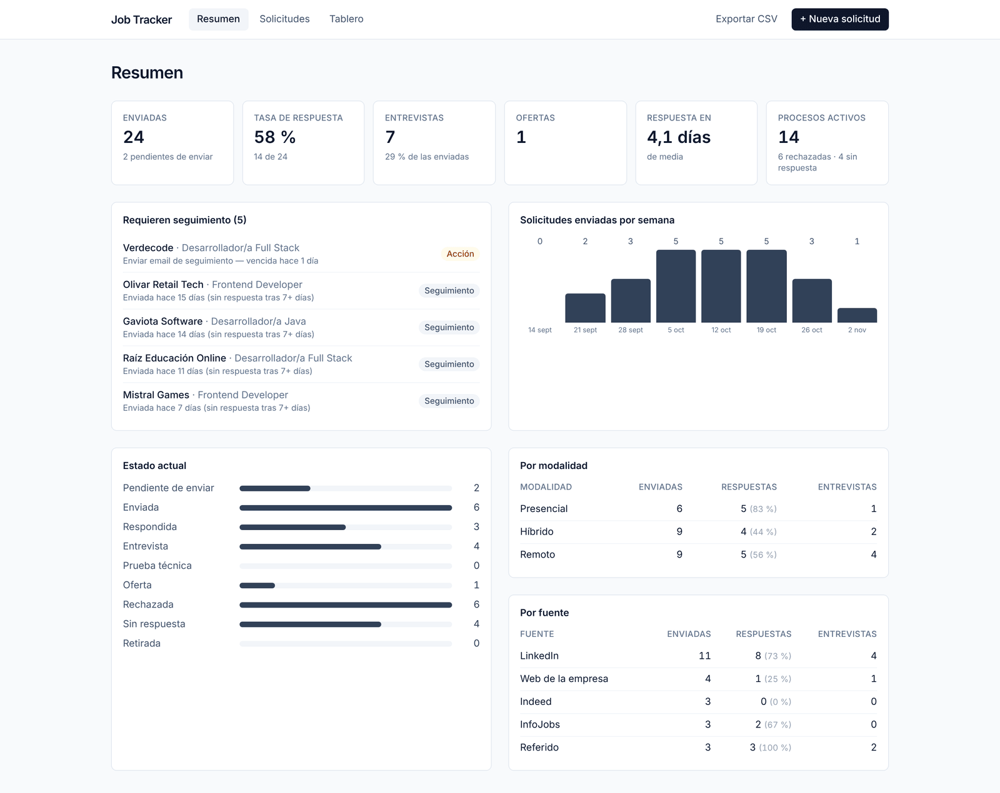
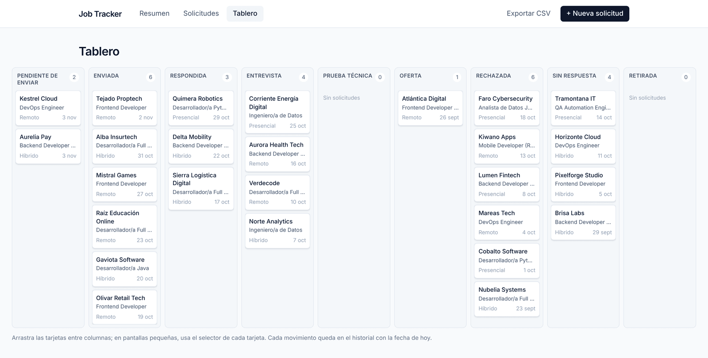
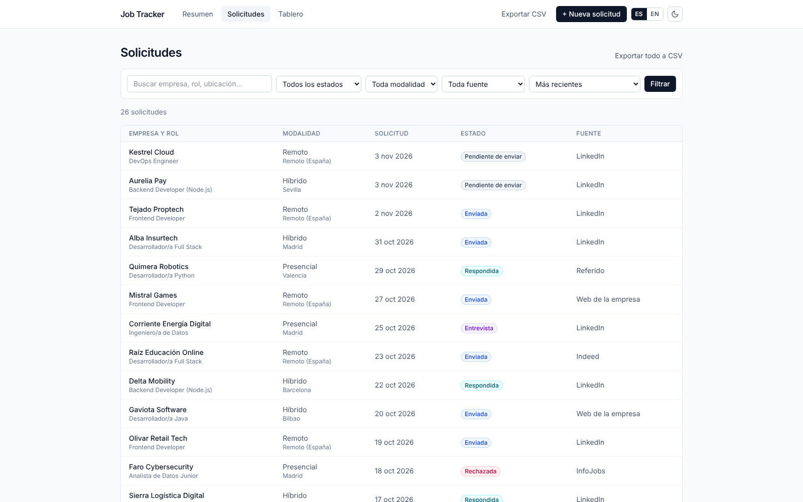
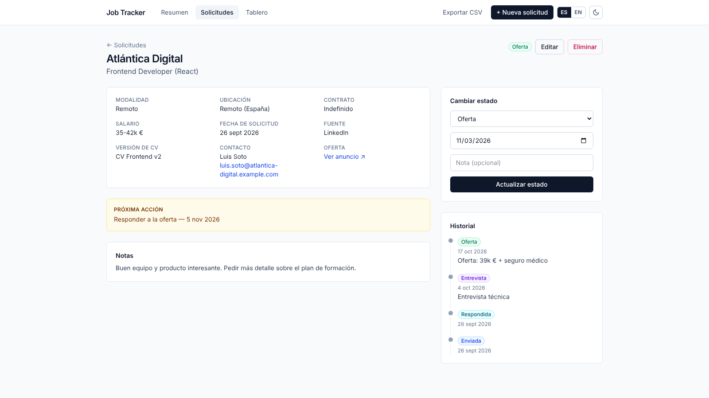
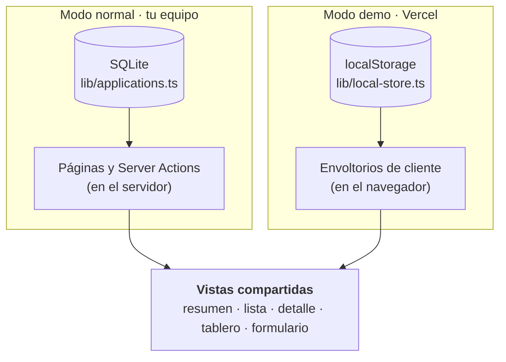

# Job Tracker

**Seguimiento de solicitudes de empleo: a qué empresa, para qué rol, en qué modalidad, cuándo, y si te han respondido.**


**[▶ Probar la demo](https://TU-PROYECTO.vercel.app)** — sin registro: los datos son ficticios y se guardan solo en tu navegador.

<p align="center">
  
</p>

## ¿Qué es?

Cuando envías decenas de candidaturas, pierdes la cuenta: ¿a quién escribí ya?, ¿cuánto tarda cada empresa en contestar?, ¿me compensa más LinkedIn o la web de la empresa?, ¿el trabajo remoto responde más que el presencial? Job Tracker responde a todo eso con una sola herramienta: registras cada solicitud, mueves su estado a medida que avanza el proceso, y la aplicación calcula las estadísticas y te avisa de lo que toca retomar.

Está pensada para el uso diario en una búsqueda de empleo real: los datos viven en tu equipo, en un único fichero SQLite, sin cuentas ni servicios externos.

## Funcionalidades

- **Panel de resumen**: solicitudes enviadas, tasa de respuesta, entrevistas, ofertas, días medios hasta la primera respuesta, rendimiento por fuente y por modalidad, y envíos por semana.
- **Seguimiento automático**: lista lo que requiere acción: próximas acciones vencidas y envíos sin respuesta pasados 7 días.
- **Tablero Kanban** con arrastrar y soltar entre los nueve estados. Cada movimiento queda en el historial.
- **Lista con búsqueda y filtros** por estado, modalidad y fuente, con varios órdenes.
- **Ficha de cada solicitud**: empresa, rol, modalidad, ubicación, contrato, salario, fuente, contacto, versión de CV enviada, notas, próxima acción y enlace a la oferta.
- **Historial de estados**: línea de tiempo con fecha y nota de cada cambio.
- **Exportación a CSV** (respeta los filtros activos), lista para abrir en Excel.

Estados: pendiente de enviar · enviada · respondida · entrevista · prueba técnica · oferta · rechazada · sin respuesta · retirada.

## Capturas

<p align="center">
  <br>
  <em>Tablero: las nueve columnas caben en pantalla; cada columna se desplaza sola si se llena.</em>
</p>

| Lista con filtros | Ficha con historial |
| :---: | :---: |
|  |  |

> Las capturas muestran los datos de ejemplo del proyecto: empresas, personas y enlaces son todos ficticios.

## Decisiones técnicas

**Dos modos con el mismo código.** La aplicación funciona de dos formas, y las pantallas son las mismas:



| | Modo normal (uso real) | Modo demo (portfolio) |
| --- | --- | --- |
| Datos | SQLite en `data/job-tracker.db`, vacío al empezar | `localStorage` del navegador de cada visitante |
| Precarga | Ninguna (el seed es opcional) | 26 solicitudes ficticias la primera vez |
| Servidor | Lee y guarda los datos | No guarda nada; las acciones del servidor están desactivadas |
| Se activa con | por defecto | `NEXT_PUBLIC_DEMO=true` |

Así la demo pública se puede desplegar sin base de datos, cada visitante tiene su propia copia aislada, y los datos reales de uso diario nunca se mezclan con los de ejemplo. En la demo, «Restablecer datos» (barra superior) devuelve los ejemplos y «Vaciar demo» (pie de página) la deja vacía para probarla desde cero.

**Un contrato, dos implementaciones, las mismas pruebas.** Las dos capas de datos (`lib/applications.ts` sobre SQLite y `lib/local-store.ts` sobre el navegador) cumplen la interfaz `Repository`. Una única batería de pruebas se ejecuta contra ambas, de modo que no pueden comportarse de forma distinta sin que falle un test.

**Historial en lugar de sobrescribir.** Cada cambio de estado es una fila nueva en `status_history`. De ahí salen el tiempo de respuesta y la línea de tiempo, y una solicitud cuenta como «respondida» si alguna vez recibió respuesta, aunque después se rechazara o pasara a «sin respuesta».

**Lógica de negocio en funciones puras.** Estadísticas (`lib/stats.ts`), validación (`lib/validation.ts`), CSV (`lib/csv.ts`) y fechas (`lib/dates.ts`) no dependen de React, de la base de datos ni del reloj del sistema, y por eso se prueban sin montar nada.

**Detalles que importan:**

- Consultas SQL parametrizadas, orden elegido de una lista cerrada y comodines de `LIKE` escapados en la búsqueda.
- Validación en el servidor con errores por campo; los enlaces solo admiten `http(s)://`, así que un `javascript:` se rechaza.
- El CSV neutraliza celdas que empiezan por `=`, `+`, `-` o `@` para evitar la inyección de fórmulas en Excel, usa `;` como separador y UTF-8 con BOM para abrirse bien en Excel en español.
- Las fechas son cadenas `YYYY-MM-DD`, sin hora ni zona horaria, para evitar desfases entre servidor y navegador.
- Arrastrar y soltar con la API nativa del navegador, sin librerías; en pantallas pequeñas y con teclado hay un selector en cada tarjeta como alternativa.
- Gráficos hechos con HTML y CSS, sin librería de gráficos. Las únicas dependencias de ejecución son Next, React y `better-sqlite3`.

## Stack

| Capa | Tecnología |
| --- | --- |
| Framework | Next.js 15 (App Router, Server Actions) |
| UI | React 19, Tailwind CSS 4 |
| Lenguaje | TypeScript en modo estricto |
| Datos | SQLite con `better-sqlite3` (modo normal) · `localStorage` (modo demo) |
| Pruebas | Test runner de Node (`node:test`) con `tsx` |

## Ejecutarlo en local

Requisitos: Node.js 20.9 o superior.

```bash
git clone <url-del-repositorio>
cd job-tracker
npm install
npm run dev
```

Abre <http://localhost:3000>. La base de datos se crea sola en `data/job-tracker.db`, vacía. Para verlo con datos de ejemplo, ejecuta `npm run seed` antes de arrancar.

Si `npm install` no puede obtener o compilar `better-sqlite3` (módulo nativo), instala las herramientas de compilación de tu sistema; en Windows, las «Herramientas de compilación de Visual Studio» con la carga de trabajo de C++.

| Comando | Qué hace |
| --- | --- |
| `npm run dev` | Servidor de desarrollo |
| `npm run build` · `npm start` | Compilar y servir en producción |
| `npm run seed` | Carga los datos de ejemplo (solo si la base de datos está vacía) |
| `npm run seed -- --reset` | **Borra todo** y vuelve a cargar los ejemplos |
| `npm run dev:demo` · `build:demo` · `start:demo` | Lo mismo en **modo demo** |
| `npm test` | Pruebas unitarias |
| `npm run typecheck` | Comprobación de tipos |

La ruta de la base de datos se puede cambiar con la variable de entorno `DATABASE_PATH`. El fichero está en `.gitignore`: contiene datos personales y no debe subirse a un repositorio.

Al alternar entre modo normal y demo, borra antes la carpeta `.next`: el modo se fija al compilar.

## Publicar la demo en Vercel

No necesita base de datos.

1. Sube el repositorio a GitHub.
2. En Vercel, **Add New… → Project** e importa el repositorio (detecta Next.js solo).
3. En **Environment Variables**, añade `NEXT_PUBLIC_DEMO` con el valor `true`.
4. **Deploy**.

## Estructura

```
src/
  app/              páginas (App Router), Server Actions y la ruta /api/export
  components/
    views/          pantallas reutilizables: resumen, lista y ficha
    demo/           envoltorios del modo demo (leen y escriben en el navegador)
                    …más formulario, tablero Kanban y panel de estadísticas
  lib/
    applications.ts capa de datos del modo normal (SQLite)
    local-store.ts  capa de datos del modo demo (localStorage)
    repository.ts   contrato que cumplen ambas capas
    stats.ts        estadísticas y seguimiento
    validation.ts   validación de formularios y filtros
    csv.ts · dates.ts · format.ts · constants.ts · types.ts
    seed-data.ts    datos de ejemplo ficticios
scripts/seed.ts     carga de datos de ejemplo
tests/              pruebas (el contrato de datos se ejecuta contra las dos capas)
docs/screenshots/   capturas de pantalla de este README
```

## Modelo de datos

- **`applications`**: una fila por solicitud, con su estado actual.
- **`status_history`**: una fila por cada cambio de estado, con fecha y nota.

`status` y `work_mode` se validan en la aplicación y no con `CHECK` de SQL, para poder añadir estados nuevos sin migrar la base de datos. Si una solicitud «pendiente de enviar» pasa a «enviada», su fecha de solicitud pasa a ser la del envío.

## Limitaciones y próximos pasos

- **Un solo usuario, sin autenticación.** En modo normal está pensada para ejecutarse en tu propio equipo: cualquiera que llegue al servidor puede ver y modificar todo. Para alojar el modo normal en internet haría falta añadir autenticación y migrar los datos a Postgres.
- **La demo no comparte datos entre dispositivos**: viven en el navegador de cada visitante, y se pierden si borra los datos del sitio.
- Ideas pendientes: importar solicitudes desde CSV, copias de seguridad automáticas, recordatorios por correo y extraer los datos de una oferta a partir de su enlace.
